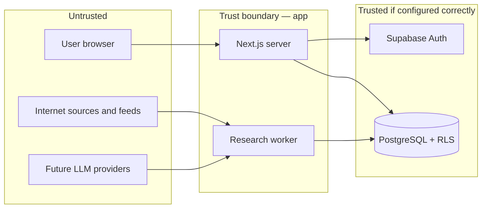

# Information security standard (canonical)

**Status:** canonical engineering requirement  
**Owner:** founder  
**Last verified:** 17 October 2026  
**Scope:** Aqil monorepo (`apps/web`, `workers/research`, `supabase/`, `packages/contracts`)  
**Not:** ISO 27001 certification, SOC 2, or a full ISMS programme. Control references below are **mapping aids** only; they do not reproduce standard text or imply third-party attestation.

**Related:** `06_ENGINEERING_DISCIPLINE.md`, `AUTH_AND_SESSION_DOCTRINE.md`, `04_ARCHITECTURE_AND_DATA.md`, `07_ROADMAP_AND_GATES.md`, `10_ACCEPTANCE_TEST_MATRIX.csv`.

---

## 1. Purpose and principles

1. **Security enables product work** — proportionate controls; no artificial blockers for public-data research prototypes.
2. **Fail closed on private data** — identity, RLS and route guards deny by default; ambiguous auth never renders wealth or settings.
3. **Git is schema truth** — migrations and pgTAP pass locally and in CI before any hosted apply; MCP is not a second migration path.
4. **Untrusted inputs** — internet content, uploads, syndicated feeds and LLM outputs are data, not authority.
5. **Evidence over assertion** — a control is **implemented** only when verified (CI green, test executed, or configured service); otherwise it is **required** or **future** per §7.

---

## 2. Requirements (summary)

| Domain | Requirement | ISO 27002:2022 (themes) | OWASP ASVS 5.0 (themes) |
|--------|-------------|-------------------------|---------------------------|
| Identity & access | Unique human accounts; MFA on GitHub and production consoles before public launch; least privilege on DB roles, CI and cloud | 5.15–5.18, 8.2–8.5 | V1, V4 |
| Authentication & sessions | Cookie SSR (`@supabase/ssr`); one server auth decision per request; no client `getSession()` as access grant | 8.5, 8.24 | V2, V3 |
| Database isolation | RLS on every private table; explicit `REVOKE ALL` then narrow `GRANT`; pgTAP under `authenticated` | 8.3, 8.4 | V4, V13 |
| Encryption | TLS for all client and API traffic; rely on Supabase/platform at-rest encryption; no custom crypto | 8.24, 8.11 | V2, V14 |
| Secrets | No secrets in Git; service role server-only; env separation dev/preview/prod | 5.32–5.37, 8.4 | V2, V14 |
| Secure development | PR review; risk class R0–R3; lockfiles; dependency audit policy | 8.25–8.28 | V1, V14 |
| Data classification | Public research vs private wealth; minimisation; retention and delete/export before commercial launch | 5.12–5.14, 8.10 | V8 |
| Integrity & audit | Append-only research history; idempotent ingestion; build identity on release | 8.15–8.16 | V8, V11 |
| Logging & IR | Structured logs; no tokens or portfolio amounts; factual incidents in `INCIDENTS.md` when created | 8.15–8.16, 5.24–5.28 | V7, V11 |
| Backup & recovery | Encrypted backups; tested restore before relying on hosted wealth data | 8.13–8.14 | V14 |
| Third parties | Data-processing review for Supabase, GitHub, future LLM and market-data vendors | 5.19–5.23 | V1 |
| Environments | Separate keys and data; no synthetic seeds unlabelled in production | 8.31 | V1 |
| Change management | Migrations via Git; founder approval for production DDL and permission changes | 8.32 | V1 |

OWASP **Top 10 (2021)** alignment is achieved through the above (broken access control → RLS + guards; cryptographic failures → TLS/platform; injection → parameterised queries/RLS; SSRF → fetch allowlists when built; security misconfiguration → grants tests; vulnerable components → audit; auth failures → doctrine; integrity → provenance; logging → §5; SSRF/supply chain → §6).

---

## 3. Trust boundaries and threat model

**Prioritised threats**

| ID | Threat | Primary impact |
|----|--------|----------------|
| T1 | Stolen or fixed session (XSS, device theft, token leak) | Account takeover; private data read/write |
| T2 | Cross-tenant data access (IDOR, missing RLS, service role misuse) | Financial privacy breach |
| T3 | `SUPABASE_SERVICE_ROLE_KEY` or CI secret exposure | Full database bypass |
| T4 | Malformed or malicious research payloads (PDF, HTML, RSS) | Code execution, SSRF, data poison |
| T5 | Prompt injection via research sources | Policy bypass, exfiltration, tool abuse |
| T6 | Accidental deletion or bad migration | Data loss, outage |
| T7 | Compromised npm/PyPI dependency or tampered CI | Supply-chain takeover |
| T8 | Unauthorised hosted DDL (MCP, dashboard, wrong project) | Schema drift, open data |
| T9 | Credential stuffing / OAuth misconfiguration | Account takeover |
| T10 | Unbounded AI or fetch jobs | Cost abuse, DoS |

**Control types (per threat)**

- **Preventive:** RLS, explicit grants, server-only service role, input validation, allowlisted outbound fetch (when implemented), budget caps, MFA, branch protection.
- **Detective:** CI pgTAP, type diff, audit logs (when wired), `npm audit`, GitHub secret scanning, anomaly alerts (future).
- **Recovery:** Backups, migration rollback plan, incident runbook, versioned research corrections.

---

## 4. Risk register (living)

Severity: **C** critical, **H** high, **M** medium, **L** low. Status: **Open**, **Mitigated**, **Accepted**, **Deferred**.

| ID | Risk | Sev | Mitigation | Owner | Status |
|----|------|-----|------------|-------|--------|
| R1 | Auth not implemented; private routes undefined | H | Ship per `AUTH_AND_SESSION_DOCTRINE.md` before any private wealth UI | Engineering | Open |
| R2 | Hosted DB has no migrations applied; manual drift risk | M | `db push` only after CI pgTAP + explicit approval; never `test db --linked` | Founder | Mitigated (process) |
| R3 | Service role imported client-side | C | `server-only` boundary; CI grep / review checklist | Engineering | Mitigated (partial — no automated bundle scan yet) |
| R4 | Default Supabase table grants (`TRUNCATE`, `TRIGGER`) | H | `REVOKE ALL` pattern + pgTAP negatives on `user_settings` | Engineering | Mitigated |
| R5 | Dev-only npm audit highs (`braces` chain) | L | Track; `npm audit --omit=dev` in CI; no reckless `audit fix --force` | Engineering | Accepted |
| R6 | No MFA on founder GitHub/hosted consoles | M | Enable before public launch | Founder | Deferred |
| R7 | Research publication without registry | M | `verify_claim_for_publication` fail-closed (Python) | Engineering | Mitigated |
| R8 | LLM agents with broad DB or secret access | H | §6 rules; tool least privilege; budgets before agents ship | Engineering | Open |
| R9 | Backup restore untested on hosted | H | Restore drill in `docs/runbooks/` before wealth data | Ops | Deferred |
| R10 | Secret committed to Git | H | `.gitignore`, review, GitHub secret scanning, CI permissions | Engineering | Mitigated (partial) |

Update this table when risks close or new subsystems ship.

---

## 5. Operational rules (logging, secrets, environments)

- **Never log:** access tokens, refresh tokens, cookies, OAuth codes, raw `Authorization`, service role key, portfolio balances, personal transaction detail.
- **May log (sampled):** correlation id, route class, auth classification bucket, latency, error class, migration version, job id.
- **Secrets:** only in environment or host secret store; rotate on exposure; separate anon vs service role vs OAuth client secrets per environment.
- **Production access:** no shared passwords; no direct SQL on production without recorded change; migrations only from merged Git.
- **Client storage:** no private financial data in `localStorage`/public SW caches; sensitive responses `Cache-Control: private, no-store`.

---

## 6. Future feature security rules

Apply in design and code review when each capability is built.

| Feature | Rules |
|---------|--------|
| Supabase Auth & sessions | Full `AUTH_AND_SESSION_DOCTRINE.md`; Playwright matrix rows in `10_ACCEPTANCE_TEST_MATRIX.csv` |
| Portfolio & transactions | RLS on every row; server routes re-check tenant; golden ledger tests; no client-side balance authority |
| Market data ingestion | Licence matrix; idempotent jobs; as-of vintage; no invented prices when missing |
| External HTTP APIs | Allowlisted domains; timeouts; size limits; SSRF-safe fetchers; no internal URL callbacks |
| AI research agents | External content **untrusted**; no secrets in prompts; tools read-only unless explicitly approved; provenance on every claim; human publication gate initially; per-run and per-day cost caps |
| Financial calculations | Deterministic, versioned methods; frozen historical outputs |
| Scheduled jobs | Least-privilege DB role (not service role unless unavoidable and audited) |
| Subscriptions & entitlements | Server-side entitlement check + RLS; no client-side “is paid” flag alone |

**AI research (non-negotiable when agents ship)**

1. Retrieval and parsing run with **read-only** credentials where possible.
2. Agents cannot change security policy, invoke shell, or write arbitrary SQL.
3. Numeric claims require deterministic verification against typed observations.
4. Prompt injection in source text must not alter tool allowlists or exfiltrate env vars.
5. Usage budgets and concurrency limits are enforced in the worker, not honour-system.

---

## 7. Control status (proportionate)

### Implemented (verified as of 17 Oct 2026)

| Control | Evidence |
|---------|----------|
| Schema via Git migrations | `supabase/migrations/` |
| RLS + grant hardening on `user_settings` | Migration + 24 pgTAP cases |
| pgTAP in CI on ephemeral local stack | `.github/workflows/ci.yml` `database` job |
| Generated types match schema | CI `git diff` on `database.generated.ts` |
| Web quality gates | typecheck, lint, tokens, build, Playwright e2e |
| Research worker gates | ruff, pytest; claim verifier fail-closed |
| Service role server-only pattern | `apps/web/src/lib/env/server.ts` + `server-only` |
| Engineering doctrines | Auth, architecture hostile-input §, discipline §5–7 |
| No secrets in tracked env files | `.gitignore` |
| G0 scope guard | No live LLM/feeds/broker in rules and roadmap |

### Required before private financial data

| Control | Notes |
|---------|--------|
| End-to-end auth per doctrine | Blocks real user wealth |
| RLS + pgTAP for every private table | Repeat `user_settings` pattern |
| Route guards and `private, no-store` on wealth routes | |
| Hosted migration apply only after CI + approval | |
| Restore drill documented and executed once | |
| Production dependency audit clean (`--omit=dev`) | Already expected in CI |

### Required before public commercial launch

| Control | Notes |
|---------|--------|
| MFA on admin and production accounts | GitHub, Supabase, DNS |
| GitHub Advanced Security / secret scanning enabled on org/repo | Free for public repos; enable for private |
| Privacy policy, delete/export, incident response runbook | `08_GOVERNANCE_AND_BUSINESS.md` Phase B/C |
| Entitlement and billing security review | Before paid tier |
| Rate limiting and abuse detection on auth and APIs | |
| Python dependency audit in CI (`pip-audit` or equivalent) | When worker deps grow |
| Optional: bundle scan ensuring no service role in client JS | |

### Future (do not block macro research prototype)

| Control | Notes |
|---------|--------|
| WAF / DDoS edge | Platform defaults first |
| SIEM / centralised SOC | Overkill at founder scale |
| Formal penetration test | Before scale or regulator dialogue |
| Hardware security keys for all collaborators | When team grows |
| Automated prompt-injection regression suite | When agents ship |

---

## 8. Incident and change management

1. **Suspected breach:** rotate exposed credentials first; preserve logs; record timeline in `INCIDENTS.md` (when created); post-mortem → update this doc or `06_ENGINEERING_DISCIPLINE.md`.
2. **Vulnerable dependency:** assess exploitability in Aqil’s deployment context; patch or document acceptance in risk register.
3. **Schema change:** R2/R3 class; migration + pgTAP + types; no hosted apply without founder approval.
4. **AI or data incident:** freeze publication pipeline; mark dependent outputs for review per architecture immutability rules.

---

## 9. Review cadence

- **Each R2/R3 change:** confirm applicable rows in §7.
- **Quarterly (or before launch):** re-read risk register; confirm GitHub security settings; run `npm run test:db` and document result.
- **After major subsystem (auth, wealth, agents):** extend §4 and §6; add acceptance matrix rows if needed.

---

## 10. Document maintenance

Amend this file for new subsystems or closed risks. Do not duplicate full checklists from `06_ENGINEERING_DISCIPLINE.md` or `AUTH_AND_SESSION_DOCTRINE.md` — link and extend.
