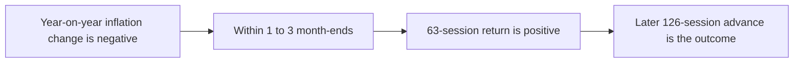

# Sequence

Experiment LH-E-011. Artifact hash `6495408b4a4136052fe8ff881d14b1c27648838851c17c1baafac80e0bfdfe4c`.

Inflation deceleration is a negative change in the atlas year-on-year ratio.
It is not a percentage-point change. Positive 63-session momentum must follow
within one to three month-ends. The 126-session advance is the later outcome.
The thresholds were not retuned on VWRA.

| Item | Value |
| --- | ---: |
| eligible | 82 |
| pair_count | 35 |
| pair_advances | 16 |
| false_positives | 19 |
| missed_advances | 21 |
| deceleration_count | 24 |
| deceleration_advances | 13 |
| momentum_count | 56 |
| momentum_advances | 24 |
| advances | 37 |
| comparison_status | no_incremental_information |
| finding_class | retrospective_exploratory |

| Statistic | Result or refusal | Row hash |
| --- | --- | --- |
| conjunction_comparison | no_incremental_information | `421229cf9eafaf2410326411b4a390aabc6c9e19e55a5047ee7c98b44a67f5e4` |
| false_positives | 19 | `c257e528185d54319fbea823500d156451d8c8f7ab718a33da2eb3284f50d930` |
| missed_advances | 21 | `fd2262589b72d5b7b3d96050f73d10e8b12cefe2dc912ff49553c6533903d882` |
| advance_rate, deceleration on 24 month-ends | 0.5416666666666666666666666667 | `f3cd77c94fd9c2594eba8f1ef4f37edd12ed44edc647854970db7744216d7f5a` |
| advance_rate, 63-session momentum on 56 month-ends | 0.4285714285714285714285714286 | `6bb497bcf3563fae4d5950dd26df046b1d4801661109ddba1336b2061f83e678` |
| advance_rate, sequence on 35 month-ends | 0.4571428571428571428571428571 | `46ed2379efa5f12c3ddf4b67632629e281192f8092dd49bd189d0510b1dfaab5` |

The sequence is not an executable strategy.
